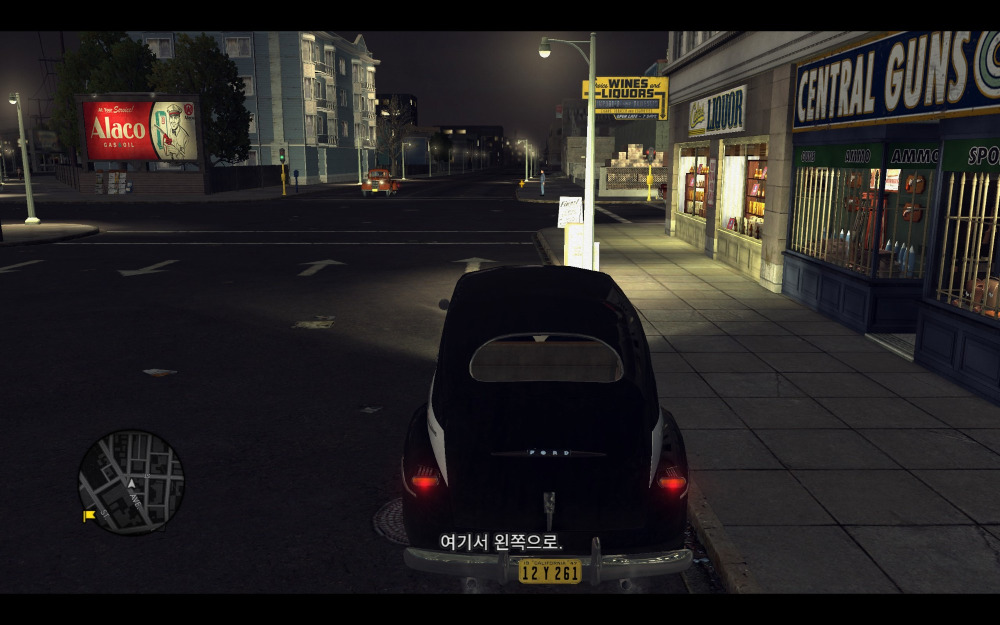
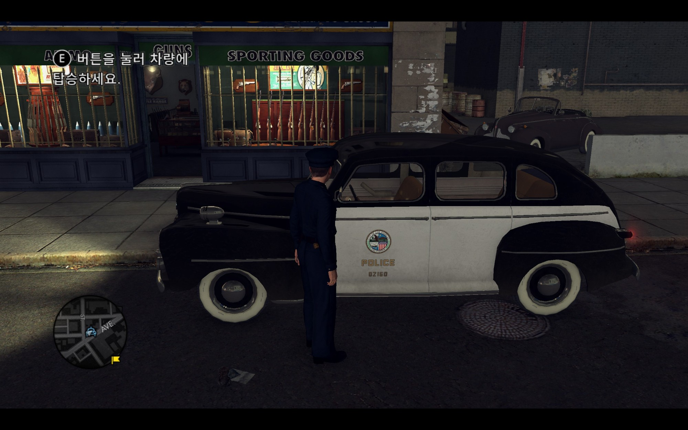
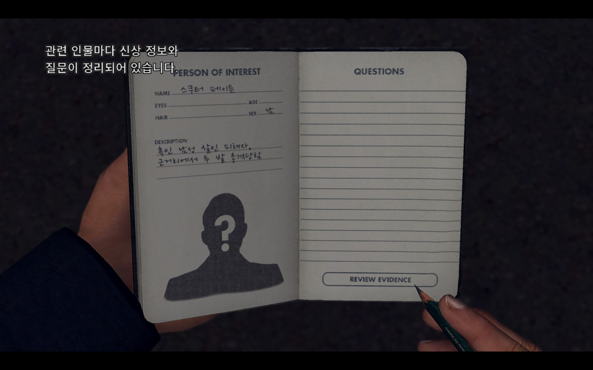
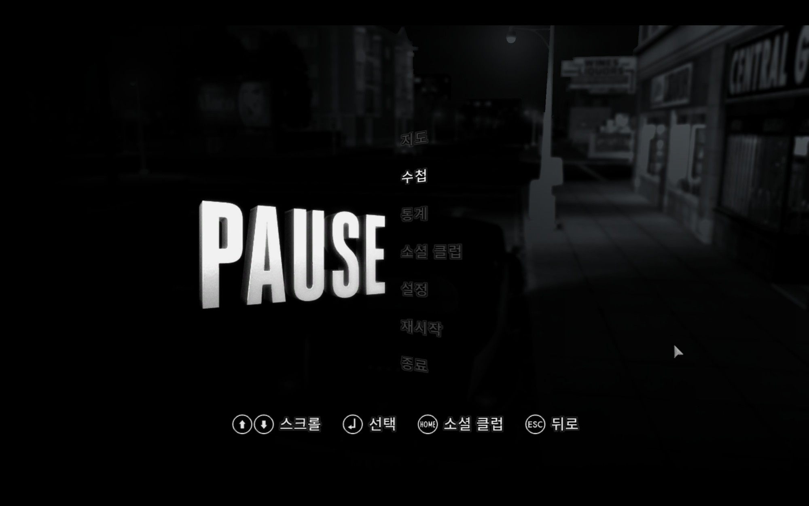

# L.A. Noire 비공식 한글패치

Steam판 **L.A. Noire**(락스타 게임즈 런처 연동 버전)용 비공식 한글패치입니다.
대사 자막, 수첩, 메뉴, 튜토리얼, 단서 설명 등 게임 내 텍스트 약 2만 2천 문장을 한국어로 옮겼습니다.

- 본편 전 사건 + DLC 사건 포함
- 필기체(수첩·대화 기록)는 나눔손글씨 펜, 그 밖의 UI는 Noto Sans KR
- `LANoire.exe`는 수정하지 않음 → 락스타 런처의 실행 파일 서명 검사에 걸리지 않음
- 원본 백업 / 원클릭 복구 지원

> 번역은 기계 번역(Claude, Gemma)을 바탕으로 했습니다. 어색한 문장이나 오역을 발견하면 [이슈](../../issues)로 알려 주세요.

## 스크린샷

| 대사 자막 | 튜토리얼 |
|---|---|
|  |  |
| **수첩 (필기체)** | **일시정지 메뉴** |
|  |  |

## 설치

1. [Releases](../../releases)에서 `LANoire_KoreanPatch_vX.X.zip`을 받아 압축을 풉니다.
2. 게임을 **한 번 실행했다가 종료**합니다(설정 파일 `settings.ini`를 만들기 위해서입니다).
3. 게임과 런처(`PlayLAN`)가 완전히 종료된 상태에서 **`한글패치_설치.bat`** 을 더블클릭합니다.
   - 게임 폴더는 Steam 라이브러리에서 자동으로 찾습니다. 못 찾으면 경로를 입력하라고 나옵니다.
   - 게임이 `Program Files` 아래에 있으면 관리자 권한 요청 창이 뜰 수 있습니다.
4. Steam에서 평소처럼 게임을 실행합니다.

파이썬이 포함되어 있어서 따로 설치할 것은 없습니다.

## 제거

**`원본_복구.bat`** 을 실행하면 원래 영어 상태로 돌아갑니다.
원본 백업은 압축을 푼 폴더의 `backup` 폴더에 저장되므로, 패치를 쓰는 동안 이 폴더를 지우지 마세요.
백업이 없어졌다면 Steam의 **속성 → 설치된 파일 → 게임 파일 무결성 검사**로 복구할 수 있습니다.

## 주의사항

- **비공식 팬 패치입니다.** 게임 파일을 직접 수정하므로 사용에 따른 책임은 사용자에게 있습니다. 문제가 생기면 `원본_복구.bat`이나 Steam 무결성 검사로 되돌릴 수 있습니다.
- **대상 버전**: Steam판 L.A. Noire(락스타 게임즈 런처 연동, `LANoire.exe` 2675 빌드)에서 확인했습니다. L.A. Noire: The VR Case Files, 리마스터판(2017), Epic·락스타 런처 단독 구매판은 확인하지 않았습니다.
- **설치·복구는 게임과 런처를 완전히 끈 상태에서** 하세요. 게임 창을 닫아도 `LANoire.exe` / `PlayLAN.exe`가 작업 관리자에 남아 있는 경우가 있습니다.
- **설치 전에 게임을 한 번 실행**해야 `settings.ini`가 만들어집니다. 없으면 언어 설정을 바꾸지 못합니다.
- **`backup` 폴더를 지우지 마세요.** 원본 복구에 필요합니다. 압축을 푼 폴더를 옮기거나 지우면 `원본_복구.bat`을 쓸 수 없고, 이때는 Steam 무결성 검사로 복구해야 합니다.
- **Steam 무결성 검사를 하면 패치가 풀립니다.** 다시 쓰려면 `backup` 폴더를 지우고 `한글패치_설치.bat`을 다시 실행하세요.
- **게임 언어 설정을 바꾸지 마세요.** 게임은 Russian으로 설정되어 있어야 한글이 나옵니다. Steam 실행 옵션에 언어 관련 옵션도 넣지 마세요.
- **다른 모드와 함께 쓰는 경우** `out.wad.pc`, `cases.big.pc`, `dlc.dlc*.big.pc`를 수정하는 모드와는 충돌할 수 있습니다. 한글패치를 마지막에 설치하는 것을 권장합니다.
- **세이브 파일은 수정하지 않습니다.** 패치 전후의 세이브를 그대로 이어서 쓸 수 있습니다.
- **번역 품질**: 기계 번역 기반이라 말투가 사건마다 조금 다르거나 어색한 문장이 있을 수 있습니다.
- **bat 실행 시 Windows SmartScreen 경고**가 뜰 수 있습니다. `추가 정보 → 실행`을 누르면 됩니다. 포함된 `python\python.exe`는 python.org 공식 임베드 배포판(Python Software Foundation 서명)입니다.
- 패치 파일을 유료로 판매하거나 유료 배포물에 포함하지 마세요(나눔글꼴 라이선스 조건 포함).

## 자주 묻는 질문

**게임 언어가 Russian으로 바뀌어요.**
정상입니다. 현재 버전의 `LANoire.exe`는 일본어를 강제로 영어로 되돌리고, 런처는 수정된 exe의 실행을 거부합니다(오류 코드 7002.1).
그래서 이 패치는 러시아어 슬롯에 한국어를 넣고, 러시아어용 폰트를 한글 폰트로 연결하는 방식으로 동작합니다.

**한글이 안 나오고 영어로 나와요.**
- Steam 실행 옵션에 `-L Japanese` 같은 언어 옵션이 있다면 지워 주세요.
- `문서\Rockstar Games\L.A. Noire\settings.ini`의 `Language:`가 `Russian`인지 확인해 주세요.

**게임 업데이트 후 한글이 사라졌어요.**
`backup` 폴더를 지운 뒤 `한글패치_설치.bat`을 다시 실행하세요. 백업이 업데이트 전 파일이면 복구 시 업데이트가 되돌려질 수 있습니다.

## 동작 방식

| 대상 | 내용 |
|---|---|
| `final/pc/out.wad.pc` | UI 문자열(`root.atb`)의 러시아어 필드를 한국어로 교체, 폰트 정의 10개의 러시아어 항목을 한글 폰트로 연결, 일본어 폰트 2종을 한글 폰트로 교체, 키릴 문자가 그려진 UI 이미지를 영어판 이미지로 교체 |
| `final/pc/cases.big.pc`, `dlc.dlc*.big.pc` | 사건별 문자열 테이블(ATB)의 러시아어 필드를 한국어로 교체. 수정한 항목만 아카이브 끝에 덧붙이고 목차를 새로 씀 |
| `settings.ini` | `Language:Russian` |

번역이 없거나 원문과 `[2s]`, `[ACCEPT|PCSELECT]` 같은 태그가 맞지 않는 문장은 영어 원문을 그대로 씁니다.

## 저장소 구성

```
installer/         배포용 설치 프로그램 (표준 라이브러리만 사용) 과 bat 파일
tools/             개발 도구 (문자열 추출, 폰트 생성, DXT5 인코더, 번역 스크립트 등)
translation/       번역 데이터 - bNNN_*.jsonl ({"k": 영어 원문 sha1 앞 12자리, "ko": 번역}), id_overrides.json
fonts/             나눔손글씨 펜 (+ 라이선스)
translation_guide.md  번역 규칙·용어집
build_release.py   배포 zip 생성
```

게임에서 추출한 영어/일본어 원문은 게임 저작물이라 저장소에 포함하지 않았습니다. 직접 빌드하려면 게임이 설치된 PC에서 아래 순서로 진행합니다(Python 3, `numpy`, `Pillow` 필요, `tools/common.py`의 게임 경로 수정).

```bash
python tools/extract.py source/strings.jsonl   # 게임에서 원문 추출
python tools/make_batches.py                   # 번역 배치 생성 (source/batches)
python tools/check_batch.py b000               # 번역 누락/태그 검사
python build_release.py --version 1.0          # dist/ 에 배포 zip 생성
```

`build_release.py`는 `build/python-3.13.17-embed-amd64.zip`(python.org 임베드용 배포판)을 패키지에 포함합니다.

## 크레딧 · 라이선스

- 아카이브 포맷 분석 참고: [Baromir19/LANoireTools](https://github.com/Baromir19/LANoireTools)
- UI 글꼴: Noto Sans KR — SIL Open Font License 1.1
- 필기체 글꼴: 네이버 나눔손글씨 펜 — 이 패치에는 네이버에서 제공한 나눔글꼴이 적용되어 있습니다. ([라이선스](fonts/NanumPen_LICENSE.txt))
- 파이썬 런타임: Python 3.13 embeddable — PSF License

L.A. Noire는 Rockstar Games / Take-Two Interactive의 상표입니다. 이 패치는 비공식 팬 패치이며 Rockstar Games와 관련이 없습니다.
게임 아카이브 파일은 배포하지 않으며, 사용자의 게임 파일을 직접 수정하는 방식으로 동작합니다.
(패치용 폰트에는 게임 원본 폰트의 영문·버튼 아이콘 글리프가 함께 들어 있습니다.)
